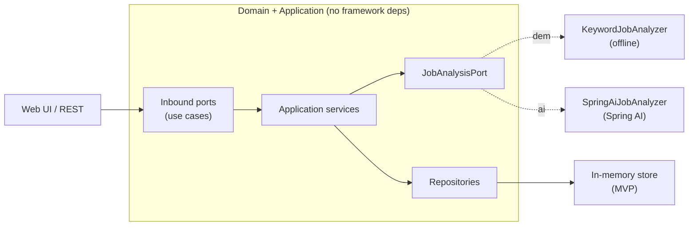

# JobLens — AI Job-Application Assistant

Paste a job description; JobLens extracts its requirements, matches them against a
**skills-only profile (no personal data)**, and generates a fit report plus
tailored, PII-free application material — then tracks it on a Kanban board.

Built with **Java 21 + Spring Boot**, **Spring AI**, and a clean **hexagonal
architecture**. It runs out of the box with **zero setup** (offline demo mode) and
swaps to a real LLM by flipping one profile.

> Status: MVP. See the [roadmap](#roadmap). This is an evolving showcase project.

---

## Highlights

- **Spring AI** analysis: requirement extraction, fit reasoning, and generation of
  resume bullets + a cover-letter draft — mapped to a typed result via Spring AI's
  structured output.
- **Bring your own skills**: any visitor can edit the profile (headline, years,
  skills) so the analysis applies to *them*, not a fixed sample. The profile lives
  only in the browser (`localStorage`) and travels with each request.
- **Privacy by design**: the profile has no fields for name/email/employer, and no
  one's profile is stored server-side. Even generated text uses `[Your Name]` /
  `[Company]` placeholders, so the public demo is safe.
- **Zero-setup demo mode**: a deterministic, offline analyzer (with
  transferable-skill detection, e.g. RabbitMQ ↔ Kafka) means the demo works with no
  API key, no network, no database.
- **Hexagonal architecture**: the domain and use cases depend only on ports; the
  web, AI, and persistence adapters plug in at the edges.
- **Provider-agnostic AI**: OpenAI, Groq, or a local **Ollama** endpoint — chosen
  by configuration, not code.

## Architecture



The core (`domain`, `application`) knows nothing about Spring AI, the web, or how
data is stored — those are swappable adapters under `adapter/`.

## Quickstart

**Requirements:** JDK 21. (Docker optional.)

```bash
# Run the offline demo (no API key needed)
./gradlew bootRun
# open http://localhost:8080
```

Or with Docker:

```bash
docker compose up --build
# open http://localhost:8080
```

### Enable real AI

```bash
# OpenAI (or any OpenAI-compatible API)
export OPENAI_API_KEY=sk-...
./gradlew bootRun --args='--spring.profiles.active=ai'
```

Point it at a **local, free** model instead by running Ollama and setting:

```bash
export OPENAI_API_KEY=ollama
export JOBLENS_AI_BASE_URL=http://localhost:11434
export JOBLENS_AI_MODEL=llama3.1
./gradlew bootRun --args='--spring.profiles.active=ai'
```

## API

| Method & path | Purpose |
|---|---|
| `POST /api/analyze` | Analyze a JD against an optional visitor profile |
| `POST /api/applications` | Analyze (with optional profile) and save to the board |
| `GET /api/applications` | List tracked applications |
| `PATCH /api/applications/{id}/status` | Move a card (`{ "status": "APPLIED" }`) |
| `DELETE /api/applications/{id}` | Remove a card |
| `GET /api/profile` | Read the read-only **sample** profile (used to pre-fill the UI) |

The request body carries an **optional `profile`**. When present, the analysis uses
it; when omitted, the server falls back to its sample profile. Profiles are never
stored server-side — the web UI keeps the visitor's profile in `localStorage` and
sends it per request.

```bash
curl -s -X POST http://localhost:8080/api/analyze \
  -H "Content-Type: application/json" \
  -d '{
        "jobDescription": "Frontend Engineer. Requirements: React, TypeScript, REST APIs.",
        "profile": { "headline": "Frontend Engineer", "yearsOfExperience": 3,
                     "skills": ["React", "TypeScript", "REST APIs"] }
      }'
```

## Tech

Java 21 · Spring Boot 3.4 · Spring AI 1.0 · Spring Web · Bean Validation ·
JUnit 5 · Gradle · Docker · GitHub Actions.

## Project layout

```
domain/model            # pure records/enums (SkillProfile, JobAnalysis, ...)
application/port/in     # use-case interfaces (inbound ports)
application/port/out    # repository & analysis interfaces (outbound ports)
application/service     # use-case implementations
adapter/in/web          # REST controllers + DTOs
adapter/out/ai          # KeywordJobAnalyzer (demo) + SpringAiJobAnalyzer (ai)
adapter/out/persistence # in-memory repositories (MVP)
```

## Roadmap

- [ ] **PostgreSQL + Spring Data JPA** persistence (replace in-memory store)
- [ ] **pgvector** embeddings for semantic skill matching
- [ ] **Spring Security (JWT)** accounts for multiple profiles
- [ ] Split the AI analysis into its own **microservice** behind an API gateway
- [ ] Rate limiting for the hosted demo
- [ ] Browser extension to capture a posting in one click

## License

[MIT](LICENSE) © 2026 Elijah Gabriel Centeno
