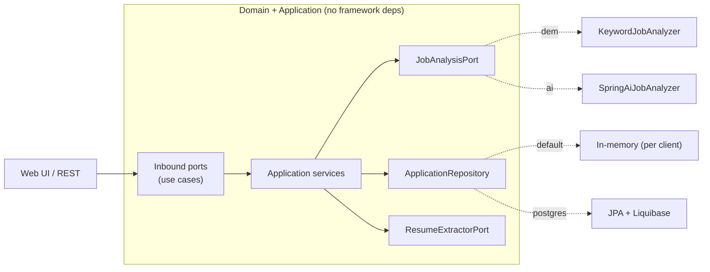

# JobLens — AI Job-Application Assistant

Bring a job posting — **paste it, upload a PDF, fetch a URL, or drop a screenshot** —
and JobLens extracts its requirements, matches them against a **skills-only profile
(no personal data)**, and generates a fit report plus tailored, PII-free application
material. Save postings to a per-visitor Kanban board.

Built with **Java 21 + Spring Boot**, **Spring AI**, and a clean **hexagonal
architecture**. Runs out of the box with **zero setup** (offline demo mode), swaps to
a real LLM by flipping one profile, and persists to **PostgreSQL** under another.

🔗 **Live demo:** https://joblens-9ucp.onrender.com · **API docs:** `/swagger-ui.html`

---

## Highlights

- **Bring a posting four ways** — paste, **PDF upload** (Apache PDFBox), **URL import**
  (jsoup, SSRF-hardened), or **image/screenshot** — paste, drag-drop, or choose a file,
  read with **offline OCR (Tesseract)** or an AI vision model in AI mode.
- **Bring your own skills** — an editable profile (headline, years, skills with
  autocomplete) that lives only in the browser and travels with each request;
  **autofill from a pasted résumé** too. Nothing about a visitor is stored server-side.
- **Spring AI** analysis (requirement extraction, fit reasoning, résumé/cover-letter
  generation) with a deterministic **offline analyzer** as the zero-setup default.
- **Per-visitor board** — scoped by an anonymous `X-Client-Id`, so the public demo
  isn't a shared free-for-all. Backed by in-memory storage, or **PostgreSQL + Spring
  Data JPA + Liquibase** under the `postgres` profile.
- **Polished UX** — dark/light theme, loading states, copy-to-clipboard, inline
  validation, toasts, keyboard shortcut (Ctrl/Cmd+Enter).
- **Production hygiene** — OpenAPI/Swagger UI, Spring Boot Actuator health, consistent
  error payloads (`@RestControllerAdvice`), and a simple per-client rate limiter.
- **Provider-agnostic AI** — OpenAI, Groq, or a local **Ollama** endpoint, by config.

## Architecture



The core (`domain`, `application`) knows nothing about Spring AI, the web, PDFBox, or
how data is stored — those are swappable adapters under `adapter/`.

## Quickstart

**Requirements:** JDK 21. (Docker optional.)

```bash
# Offline demo (no API key, no DB)
./gradlew bootRun
# open http://localhost:8080
```

Or with Docker: `docker compose up --build`.

### Enable real AI (adds AI-mode features: better analysis, résumé parsing, image import)

```bash
export OPENAI_API_KEY=sk-...
./gradlew bootRun --args='--spring.profiles.active=ai'
```

Point it at a **local, free** model instead by running Ollama and setting
`OPENAI_API_KEY=ollama`, `JOBLENS_AI_BASE_URL=http://localhost:11434`,
`JOBLENS_AI_MODEL=llama3.1`.

### Enable PostgreSQL persistence

The `postgres` profile combines with an analyzer profile (`demo` or `ai`). Liquibase
manages the schema; the board becomes durable.

```bash
docker run -d --name joblens-pg -e POSTGRES_DB=joblens -e POSTGRES_USER=joblens \
  -e POSTGRES_PASSWORD=joblens -p 5432:5432 postgres:16-alpine

JDBC_DATABASE_URL=jdbc:postgresql://localhost:5432/joblens \
JDBC_DATABASE_USERNAME=joblens JDBC_DATABASE_PASSWORD=joblens \
./gradlew bootRun --args='--spring.profiles.active=demo,postgres'
```

The live demo stays in-memory (`SPRING_PROFILES_ACTIVE=demo`) on purpose — no DB to
maintain.

## API

Interactive docs at **`/swagger-ui.html`**. All board calls are scoped by an
`X-Client-Id` request header (the browser sends a random id).

| Method & path | Purpose |
|---|---|
| `POST /api/analyze` | Analyze a JD against an optional visitor `profile` |
| `POST /api/applications` | Analyze + save to the client's board |
| `GET /api/applications` | List the client's board |
| `PATCH /api/applications/{id}/status` | Move a card |
| `DELETE /api/applications/{id}` | Remove a card |
| `GET /api/profile` | Read the read-only sample profile |
| `POST /api/profile/extract` | Extract a skills profile from résumé text |
| `GET /api/skills?q=` | Skill autocomplete |
| `POST /api/import/pdf` | Extract JD text from a PDF (multipart) |
| `POST /api/import/url` | Extract JD text from a public URL |
| `POST /api/import/image` | Extract JD text from a screenshot (offline OCR; AI vision in AI mode) |
| `GET /actuator/health` | Health check |

```bash
curl -s -X POST http://localhost:8080/api/analyze \
  -H "Content-Type: application/json" \
  -d '{"jobDescription":"Frontend Engineer. Requirements: React, TypeScript, REST APIs.",
       "profile":{"headline":"Frontend Engineer","yearsOfExperience":3,
                  "skills":["React","TypeScript","REST APIs"]}}'
```

## Tech

Java 21 · Spring Boot 3.4 · Spring AI 1.0 · Spring Web · Spring Data JPA · Liquibase ·
PostgreSQL · Bean Validation · Actuator · springdoc-openapi · Apache PDFBox · jsoup ·
Tesseract/Tess4J (OCR) · JUnit 5 · Testcontainers · Gradle · Docker · GitHub Actions.

## Roadmap

- [x] PostgreSQL + Spring Data JPA + Liquibase persistence (behind the `postgres` profile)
- [x] Per-visitor board scoping (anonymous client id)
- [x] Import postings from PDF / URL / image; résumé autofill; skills autocomplete
- [x] Dark/light theme, validation, rate limiting, OpenAPI, Actuator
- [ ] **pgvector** embeddings for semantic skill matching
- [ ] **Spring Security (JWT)** accounts for durable, named profiles
- [ ] Browser extension to capture a posting in one click

## License

[MIT](LICENSE) © 2026 Elijah Gabriel Centeno
